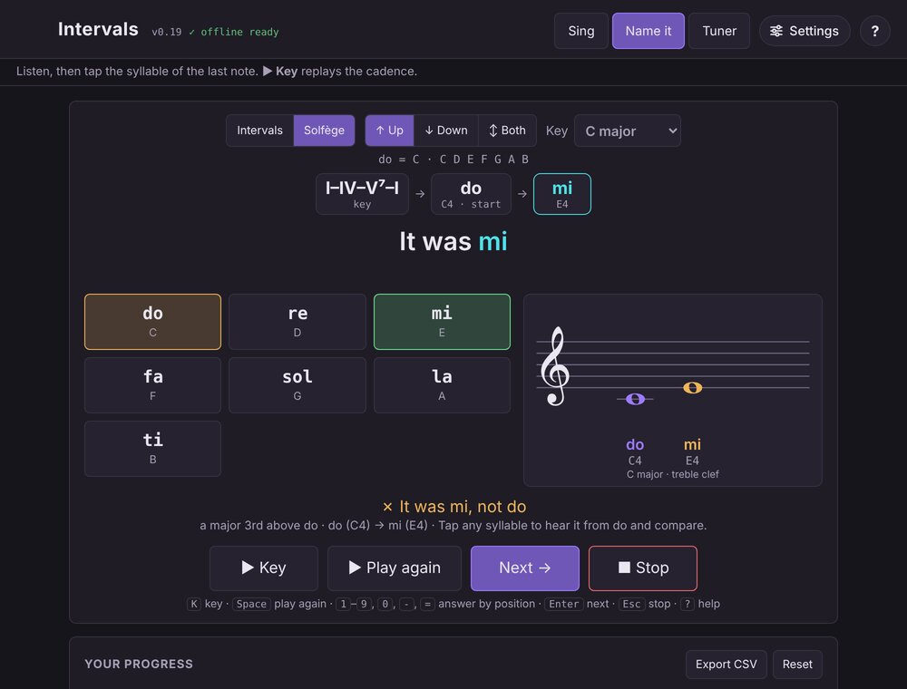

# Intervals

Ear training for singers. Intervals plays a note on a real grand piano and
asks you to sing an interval from it — a major third up, a fifth down — then
listens through your microphone and tells you how close you came, down to a
fraction of a semitone. If you think in solfège, you can drill that way
instead.

**Try it:** [dffmonolith.github.io/intervals](https://dffmonolith.github.io/intervals/)

## What it does

- **Sing:** hear a reference note and sing the interval you're asked for.
  You're graded on the median of the note you hold, after the scoop into it,
  so vibrato doesn't count against you.
- **Name it:** two notes play, melodically or harmonically, and you tap the
  interval you heard. No microphone needed. After answering, tap any interval
  to hear it from the same starting note and compare.
- **Solfège:** a switch in both Sing and Name it. Pick a major key, hear it
  established with a I–IV–V–I cadence, then do and a starting note, and sing
  or name the syllable (movable do; chromatic syllables optional). A small
  staff in your clef shows do, the starting note and the answer.
- **Direction:** Up, Down or Both, for intervals and solfège alike.
- **Tuner:** live pitch with cents sharp or flat, an optional target note,
  and a summary of each held note.
- **Setup:** voice part (Soprano to Bass) keeps every note in a comfortable
  range; choose which intervals to practise, how strict the grading is, how
  long to hold, and whether to accept the right note in another octave.
- **Progress:** accuracy, streaks, average cents off, a breakdown by interval
  of what you tend to sing or choose instead, and CSV export.
- **Help:** a built-in guide (the **?** button), with familiar tunes that
  start with each interval, and keyboard shortcuts.
- **Installable, works offline:** add it to your home screen (Safari:
  Share › Add to Home Screen; Chrome and Edge: Install). Once "✓ offline
  ready" shows beside the version number, it runs with no connection.
- **Private:** results are kept in your browser's storage. Nothing is sent
  anywhere.

## Running it

There's nothing to build. The microphone only works on a secure page, so
use the GitHub Pages link above, or serve the folder locally and open it at
`http://localhost`, for example:

    python -m http.server 8000

then visit `http://localhost:8000/`. Opened straight from disk
(`file://`), Name it works but Sing and the Tuner can't use the microphone.
Headphones help: the mic then hears you rather than the piano.

| File | Purpose |
|---|---|
| `index.html` | The whole app: HTML, CSS and JavaScript in one file |
| `intervals-piano-samples.json` | Piano samples (base64 audio) |
| `sw.js` | Service worker that keeps the app and samples for offline use |
| `manifest.webmanifest`, `icons/` | Home-screen app manifest and icons |
| `docs/` | README screenshot |

## How it works

Everything runs in the browser on the Web Audio API. Each 2048-sample
microphone window goes through McLeod's Pitch Method, a normalized
autocorrelation that finds the voice's fundamental without the octave slips
an FFT peak gives, and scores how clearly pitched the sound is, so breaths
and consonants are ignored. The staff is drawn as SVG.

## Credits

- Piano: the Salamander Grand Piano by Alexander Holm,
  [CC BY 3.0](https://creativecommons.org/licenses/by/3.0/).
- Staff glyphs: an embedded subset of Noto Music,
  [SIL Open Font License](https://openfontlicense.org/).

## License

[MIT](LICENSE) © 2026 Dennis F. Freeze (the piano samples and font subset
keep their own licenses, above).
